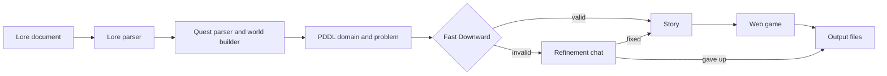

# QuestMaster

QuestMaster turns a short lore document into a playable fantasy quest. A local LLM builds the world, the
Fast Downward planner validates the quest as a PDDL planning problem and finds its optimal solution, and the
pipeline writes a story that follows that solution plus an interactive web game with the same rules.

It was built for an Artificial Intelligence course, to combine classical planning with language models.

## How it works



The pipeline is a [LangGraph](https://github.com/langchain-ai/langgraph) workflow:

1. **Lore parser:** an LLM (llama3:8b via Ollama) reads the lore document and extracts the quest
   description, the branching factor and the depth constraints. The result is validated with Pydantic.
2. **Quest parser and world builder:** the LLM extracts the destination, the required item and the obstacle.
   QuestMaster then shapes a map so that the optimal plan has a depth within the constraints, and asks the LLM
   for a name and a one-line description for every place. Names become unique, sanitized PDDL identifiers.
3. **PDDL generation:** a fixed STRIPS domain with action costs and a problem generated from the map.
4. **Validation:** Fast Downward runs A* with the LM-cut heuristic, so the plan it returns is optimal, and
   QuestMaster checks that its length respects the depth constraints.
5. **Refinement:** if validation fails, a reflection agent explains the error and proposes fixes, and you
   decide in a chat whether to apply them.
6. **Story:** the LLM writes a legend that follows the planner's solution step by step.
7. **Web game:** a static React page with the same rules as the PDDL domain, where you try to complete the
   quest in as few steps as the optimal plan.

## The planning model

The domain (`quest_master/generators/pddl_domain.py`) has three actions, each with cost 1:

| Action | What it does |
| --- | --- |
| `move` | The hero travels along a road to a place that is `clear` (not guarded). |
| `take` | The hero picks up an item found at their location. |
| `defeat_obstacle` | From a neighbouring place, the hero uses the right item against the guardian of the next place, which becomes `clear`. |

The goal is to reach the destination holding the item, with its guardian defeated, while minimizing
`total-cost`. The item is hidden on a side road, so the hero has to explore before the final fight (when the
branching factor allows no side roads, it waits at the starting place).

How the lore constraints are used:

- **Depth** is the length of the optimal plan. The generator builds the map to hit a depth inside the range,
  and the validator rejects any plan whose length falls outside it.
- **Branching factor** is the number of roads leading onward from each place on the main path.

A plan found for the sample quest (`examples/output/problem_plan.txt`):

```
(move hero mistveil_hollow raven_s_peak)
(take hero flame_of_eternity raven_s_peak)
(move hero raven_s_peak mistveil_hollow)
(move hero mistveil_hollow sagebrush_ridge)
(move hero sagebrush_ridge whispering_woods)
(move hero whispering_woods frostbite_falls)
(defeat_obstacle hero golem flame_of_eternity frostbite_falls crystal_caverns)
(move hero frostbite_falls crystal_caverns)
```

## Requirements

- **Python 3.13 or later**
- **[Ollama](https://ollama.com)** with the `llama3:8b` model
- **[Fast Downward](https://www.fast-downward.org)**, built from source. On Windows it runs inside WSL, so you
  also need a WSL Linux distribution such as Ubuntu.

## Setup

1. Download the model:
   ```bash
   ollama pull llama3:8b
   ```
2. Build Fast Downward in your home folder (on Windows, inside the WSL terminal):
   ```bash
   sudo apt update && sudo apt install -y cmake g++ make python3 git
   git clone https://github.com/aibasel/downward.git $HOME/downward
   cd $HOME/downward && ./build.py
   ```
   If you install it somewhere else, set the `FAST_DOWNWARD_PATH` environment variable to that folder.
3. Create the Python environment, from the `QuestMaster` folder:
   ```bash
   python -m venv .venv
   .venv/Scripts/python -m pip install -r requirements.txt
   ```
   On Linux and macOS the interpreter is `.venv/bin/python`.
4. Optionally, check the installation. This prints `ok`:
   ```bash
   .venv/Scripts/python test_pddl.py
   ```

## Usage

Edit `QuestMaster/lore_document.txt` to describe your quest:

```
QUEST DESCRIPTION:
The brave knight must journey to the Crystal Caverns carrying the Flame of Eternity and shatter the
Dark Crystal. The entrance is sealed by an ancient golem that awakens when intruders approach.

BRANCHING FACTOR:
Minimum: 2
Maximum: 4

DEPTH CONSTRAINTS:
Minimum: 3
Maximum: 8
```

Then run the pipeline from the `QuestMaster` folder (a run takes a few minutes, mostly LLM time):

```bash
.venv/Scripts/python main.py
```

If the generated PDDL is invalid, a refinement chat starts: type `apply`, `manual` or `skip` (or the Italian
`applica`, `modifica`, `salta`), or ask the agent questions about the error.

The results are written to `QuestMaster/examples/output/`:

| File | Content |
| --- | --- |
| `domain.pddl`, `problem.pddl` | The planning model, with the players' place names as comments |
| `problem_plan.txt` | The optimal plan found by Fast Downward |
| `narrative.txt` | The story of the quest |
| `index.html` | The game: open it in a browser (it needs internet to load React and Tailwind) |
| `metadata.json`, `final_state.json` | The quest data and the final state of the pipeline |

## Configuration

- **Models and generation settings:** `quest_master/config/llm_config.py` (model, temperature and token
  limits for each step).
- **Fast Downward location:** the `FAST_DOWNWARD_PATH` environment variable, otherwise `~/downward`.
- **WSL distribution:** the default one. To use another, pass `wsl_distro` to `PDDLValidator`.

## Project structure

```
QuestMaster/
├── main.py                      # entry point
├── lore_document.txt            # input quest
├── requirements.txt
├── test_pddl.py                 # self-check: solvability, depth, identifiers, parsing
├── frontend/
│   ├── HTMLGenerator.py         # fills the game template with the quest data
│   └── quest_template.html      # the React game
├── quest_master/
│   ├── langgraph_workflow.py    # the pipeline graph
│   ├── config/llm_config.py
│   ├── models/quest_data.py     # Pydantic models
│   ├── parsers/                 # lore parser, quest parser and world builder
│   ├── generators/              # PDDL domain, PDDL problem, story
│   ├── validators/              # Fast Downward runner and depth check
│   └── refinement/              # reflection agent and refinement chat
└── examples/output/             # a complete sample run
```

## License

[MIT](LICENSE)
